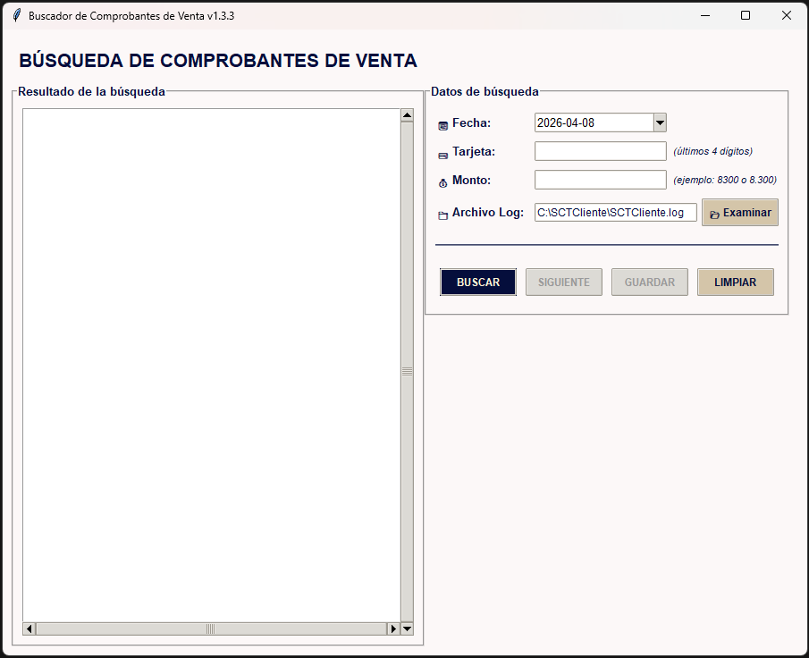

# Buscador de Comprobantes SCT
## Manual de Usuario

**Versión:** 1.3.3  
**Fecha:** Abril 2026  
**Autor:** Osvaldo Rojas G.

---

## 📋 Tabla de Contenidos

1. [Introducción](#introducción)
2. [Instalación](#instalación)
3. [Primer Uso](#primer-uso)
4. [Funcionalidades Principales](#funcionalidades-principales)
5. [Búsqueda de Comprobantes](#búsqueda-de-comprobantes)
6. [Navegación entre Resultados](#navegación-entre-resultados)
7. [Guardar Resultados](#guardar-resultados)
8. [Preguntas Frecuentes](#preguntas-frecuentes)
9. [Soporte](#soporte)

---

## Introducción

El **Buscador de Comprobantes SCT** es una herramienta que permite buscar y extraer comprobantes de venta desde archivos de log del sistema SCT. Esta aplicación facilita la localización de transacciones específicas utilizando filtros de fecha, tarjeta y monto.

### ¿Para qué sirve?

- 🔍 Buscar comprobantes de venta en archivos de log
- 💾 Guardar comprobantes encontrados en archivos de texto
- 📊 Visualizar múltiples transacciones con los mismos datos
- 🔢 Diferenciar comprobantes por hora y número de operación

---

## Instalación

### Requisitos del Sistema

- **Sistema Operativo:** Windows 10/11 (64 bits)
- **Espacio en disco:** 50 MB libres
- **Variable de entorno:** `SCT_HOME` configurada

### Pasos de Instalación

1. **Descargar el instalador**
   - Archivo: `BuscadorComprobantes_v1.3.3.exe`

2. **Ejecutar el instalador**
   - Haga doble clic en el archivo descargado
   - Si aparece una advertencia de Windows, haga clic en "Más información" → "Ejecutar de todos modos"

3. **Seguir el asistente de instalación**
   - Acepte el acuerdo de licencia
   - Seleccione la ubicación de instalación (recomendado: ubicación por defecto)
   - Haga clic en "Instalar"

4. **Finalizar**
   - Marque "Ejecutar Buscador de Comprobantes" si desea abrirlo inmediatamente
   - Haga clic en "Finalizar"

### Verificar la Instalación

- Busque el programa en el menú Inicio
- O ejecute desde el acceso directo en el escritorio (si lo seleccionó)

---

## Primer Uso

Al abrir la aplicación por primera vez, verá la siguiente interfaz:




### Configuración Inicial

La aplicación intentará cargar automáticamente el archivo de log desde:
`%SCT_HOME%\SCTCliente.log`

Si no se carga automáticamente:
1. Haga clic en **"Examinar"**
2. Navegue hasta la ubicación de su archivo de log
3. Seleccione el archivo `.log`

---

## Funcionalidades Principales

### 1. Campos de Búsqueda

#### 📅 Fecha
- Use el calendario desplegable para seleccionar la fecha de la transacción
- Formato: AAAA-MM-DD (ejemplo: 2026-04-06)
- Navegue entre meses y años usando las flechas del calendario

#### 💳 Tarjeta
- Ingrese los **últimos 4 dígitos** de la tarjeta
- Ejemplo: Si la tarjeta es `**** **** **** 6018`, ingrese `6018`

#### 💰 Monto
- Ingrese el monto de la transacción
- Puede usar formato con o sin puntos:
  - `18990` o `18.990` (ambos son válidos)

#### 📁 Archivo Log
- Muestra la ruta del archivo donde se buscará
- Use **"Examinar"** para cambiar la ubicación

---

## Búsqueda de Comprobantes

### Búsqueda Básica

1. **Complete los campos:**
   - Seleccione la fecha
   - Ingrese los últimos 4 dígitos de la tarjeta
   - Ingrese el monto

2. **Haga clic en "BUSCAR"**
   - La aplicación buscará en el archivo de log
   - Si encuentra un comprobante, lo mostrará en el panel derecho

3. **Resultado:**
   - ✅ **Encontrado:** Muestra el comprobante completo
   - ❌ **No encontrado:** Muestra mensaje de error y posibles causas

### Búsqueda de Múltiples Comprobantes

Si existen **varias transacciones** con los mismos datos (fecha, tarjeta, monto):

1. La primera búsqueda mostrará el **Comprobante #1**
2. El botón **"SIGUIENTE"** se habilitará automáticamente
3. Haga clic en **"SIGUIENTE"** para buscar más coincidencias
4. Repita hasta que el botón "SIGUIENTE" se deshabilite

**Indicadores visuales:**
- `"Total encontrados: 3 | Mostrando: #1"` - Hay 3 comprobantes, viendo el primero
- `"hay más disponibles"` - Pueden encontrarse más comprobantes
- `"Es el único vale que existe en el archivo"` - No hay más coincidencias

### Información de Cada Comprobante

Cada comprobante encontrado muestra:

```
============================================================
📋 COMPROBANTE ENCONTRADO #1
============================================================

🕐 Hora: 10:31:24
🔢 Nº Operación: 001010007
💳 Tarjeta: ***6018
💰 Monto: $18.990
------------------------------------------------------------

COMPROBANTE DE VENTA CON FIN
TARJETA DE CREDITO

IMPERIAL S.A.
Santa Rosa 7876, La Granja
Santiago
597040000502 - sctl.0.07.1

FECHA        HORA         TERMINAL
13/08/25     10:31:24     S4IMPERIAL000002

NUMERO DE TARJETA    FECHA DE EXP/MARCA
************6018     ****/MC

MONTO                $         18.990
TOTAL                $         18.990

NUMERO DE BOLETA               0
EMPLEADO                       0000

NUMERO DE OPERACION            001010007
CODIGO DE AUTORIZACION         564721 B
NUMERO UNICO                   0000000009999250813103116

TRANSACCION PREMIADA
CODIGO DEL PREMIO : 00027179

GRACIAS POR SU COMPRA
ORIGINAL COMERCIO
ACEPTO PAGAR SEGUN CONTRATO CON EMISOR

============================================================
Total encontrados: 3 | Mostrando: #1
============================================================
```

**Datos clave para diferenciar comprobantes:**
- **Hora:** Permite identificar transacciones en diferentes momentos del día
- **Nº de Operación:** Identificador único de cada transacción

---

## Navegación entre Resultados

Cuando se encuentran **2 o más comprobantes**, aparece un panel de navegación:

```
┌─────────────────────────────────────────────┐
│  [◀️ ANTERIOR]  [Vale 2 de 5]  [SIGUIENTE ▶️] │
└─────────────────────────────────────────────┘
```

### Botones de Navegación

| Botón | Función | Estado |
|-------|---------|--------|
| **◀️ ANTERIOR** | Muestra el comprobante anterior | Deshabilitado en el primer vale |
| **SIGUIENTE ▶️** | Muestra el siguiente comprobante | Deshabilitado en el último vale |
| **Label central** | Muestra posición actual | Ej: "Vale 2 de 5" |

### Flujo de Navegación

**Ejemplo con 5 comprobantes encontrados:**

1. **Inicio:** Muestra Comprobante #1
   - Botón "ANTERIOR" deshabilitado
   - Botón "SIGUIENTE ▶️" habilitado

2. **Clic en "SIGUIENTE ▶️":** Muestra Comprobante #2
   - Label: "Vale 2 de 5"
   - Ambos botones habilitados

3. **Continuar navegando** hasta Comprobante #5
   - Botón "ANTERIOR" habilitado
   - Botón "SIGUIENTE ▶️" deshabilitado

4. **Clic en "ANTERIOR":** Regresa a Comprobante #4

**Importante:** Los botones de navegación solo muestran comprobantes **ya encontrados**. Para buscar más comprobantes en el archivo, use el botón **"SIGUIENTE"** (sin flechas) del panel principal.

---

## Guardar Resultados

### Guardar un Solo Comprobante

1. Haga clic en **"GUARDAR"**
2. Seleccione la ubicación donde desea guardar el archivo
3. El nombre sugerido será: `comprobante_FECHA_TARJETA_MONTO_TIMESTAMP.txt`
4. Haga clic en "Guardar"

### Guardar Múltiples Comprobantes

Si se encontraron varios comprobantes:

1. Haga clic en **"GUARDAR"**
2. Seleccione la ubicación
3. El nombre sugerido incluirá la cantidad: `comprobantes_FECHA_TARJETA_MONTO_TIMESTAMP(5_vales).txt`
4. El archivo contendrá **todos los comprobantes encontrados**, numerados y con sus metadatos

**Contenido del archivo guardado:**

```
============================================================
RESULTADOS DE BÚSQUEDA
============================================================
Fecha: 2026-04-06
Tarjeta: ***6018
Monto: $18.990
Total comprobantes: 3
============================================================

============================================================
COMPROBANTE #1
============================================================
Hora: 10:31:24
Numero de Operacion: 001010007
Tarjeta: ***6018
Monto: $18.990
============================================================

... contenido del comprobante ...

============================================================
COMPROBANTE #2
============================================================
Hora: 14:22:15
Numero de Operacion: 00101032
Tarjeta: ***6018
Monto: $18.990
============================================================

... contenido del comprobante ...
```

---

## Preguntas Frecuentes

### ¿Por qué no encuentra mi comprobante?

Verifique lo siguiente:
- ✅ La fecha es correcta
- ✅ Los últimos 4 dígitos de la tarjeta coinciden exactamente
- ✅ El monto está correcto (sin signos de peso ni comas)
- ✅ El archivo de log contiene la transacción buscada

### ¿Qué significa "hay más disponibles"?

Significa que se encontró al menos un comprobante y existen **más coincidencias** en el archivo. Use el botón **"SIGUIENTE"** para continuar la búsqueda.

### ¿Qué significa "Es el único vale que existe en el archivo"?

Significa que se revisó todo el archivo y solo se encontró **un comprobante** que coincide con los criterios de búsqueda.

### ¿Puedo buscar comprobantes de diferentes fechas?

Sí, simplemente cambie la fecha en el calendario y presione **"BUSCAR"** nuevamente.

### ¿Dónde se guardan los comprobantes exportados?

Usted elige la ubicación al guardar. Se recomienda crear una carpeta específica como `C:\Comprobantes_Exportados\` para mantenerlos organizados.

### ¿Puedo usar la aplicación sin conexión a internet?

Sí, la aplicación funciona completamente offline. No requiere conexión a internet.

### ¿Qué hago si la aplicación muestra un error al abrir el archivo de log?

- Verifique que la variable de entorno `SCT_HOME` esté configurada
- Asegúrese de que el archivo de log existe en la ubicación indicada
- Use el botón "Examinar" para seleccionar manualmente el archivo

---

## Soporte

### Contacto

- **Desarrollador:** Osvaldo Rojas G.
- **Repositorio:** https://github.com/osvaldorojasg

### Información de Versión

Al reportar un problema, incluya:
- Versión de la aplicación (visible en el título de la ventana)
- Sistema operativo (Windows 10/11)
- Descripción detallada del problema
- Pasos para reproducir el error

### Actualizaciones

Las actualizaciones se distribuirán como nuevos archivos `.exe`. Para actualizar:
1. Descargue la nueva versión
2. Ejecute el instalador
3. La instalación sobrescribirá la versión anterior

---

**Documento creado:** Abril 2026  
**Última actualización:** Abril 2026
